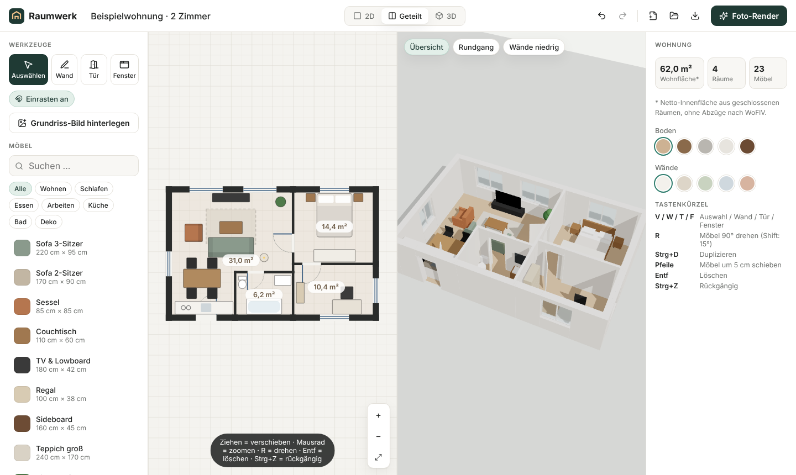

# Raumwerk: Grundriss → 3D-Wohnung → einrichten → Foto

Web-App, mit der man aus einem Grundriss in Minuten eine begehbare 3D-Wohnung macht, sie per Drag & Drop einrichtet und mit KI (Higgsfield) fotorealistische Bilder erzeugt.

📄 **Ausführlicher Produkt- und Umsetzungsplan:** [`docs/PLAN.md`](docs/PLAN.md)



## Funktionen (Stand MVP-Grundgerüst)

- **Grundriss hochladen** (JPG/PNG) und **Maßstab kalibrieren** (zwei Punkte klicken, echte Länge eingeben)
- **Wände zeichnen** mit Einrasten an Knoten, Wänden, 15°-Winkeln und 5-cm-Raster; T-Stöße; Knoten ziehen; Längen bemaßt
- **Türen und Fenster** per Klick auf die Wand, verschiebbar, Maße editierbar
- **Automatische Raumerkennung** mit m²-Angabe
- **Möbelkatalog** (24 Teile): magnetisches Andocken an Wände, Kollisionswarnung, Drehen, Duplizieren, Farben
- **3D-Ansicht** mit echten Wandöffnungen und Schatten, Möbel auch in 3D verschiebbar, „Wände niedrig“
- **Rundgang** in Augenhöhe (WASD + Maus)
- **Foto-Render** in 7 Stilen über Higgsfield (oder lokal per Mock)
- Undo/Redo, automatisches Speichern im Browser, Projekt-Export/-Import (JSON), Tastenkürzel

## Schnellstart

Voraussetzung: Node.js ≥ 22

```bash
npm install
```

```bash
cp .env.example .env
```

```bash
npm run dev
```

Dann http://localhost:5173 öffnen. Ohne Higgsfield-Key läuft der Render im **Mock-Modus**: Er gibt die 3D-Vorlage zurück, damit der ganze Ablauf testbar ist.

### Higgsfield aktivieren

In `.env`: `RENDER_PROVIDER=higgsfield`, `HIGGSFIELD_API_KEY`, `HIGGSFIELD_API_SECRET` und `PUBLIC_BASE_URL` setzen. **Vorher die Checkliste in [`docs/HIGGSFIELD.md`](docs/HIGGSFIELD.md) abarbeiten**, denn Endpunkte und Feldnamen müssen gegen die aktuelle API-Doku geprüft werden.

## Tests und Build

```bash
npm test
```

```bash
npm run typecheck
```

```bash
npm run build
```

## Projektstruktur

```
packages/core   Datenmodell, Geometrie, Raumerkennung, Snapping, Kollision, Prompts (getestet)
apps/web        React + three.js (react-three-fiber) Frontend
apps/api        Hono-API: Render-Pipeline, Higgsfield-Adapter, Uploads, Rate-Limit
docs/           Plan, Architektur, Higgsfield
```

Mehr in [`docs/ARCHITEKTUR.md`](docs/ARCHITEKTUR.md). Hinweise für die Weiterentwicklung mit Claude Code stehen in [`CLAUDE.md`](CLAUDE.md).
